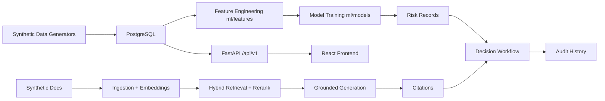

# GridOps Intelligence

**Explainable AI and predictive maintenance platform for utility asset reliability.**

> **Status:** M1–M9 complete. This is an **independent portfolio project** using
> **synthetic data only**. It is not a DTE system, is not connected to utility
> operational systems, and does not make real maintenance decisions. All data,
> documents, models, and predictions are synthetic demonstration material.

## What it does

GridOps Intelligence demonstrates an end-to-end workflow:

1. **Synthetic utility data** — assets, telemetry, maintenance, inspections, failures, weather.
2. **Leakage-safe feature engineering** — strict temporal cutoffs, per-asset event bounds, three-state labels.
3. **Predictive failure-risk modeling** — Logistic Regression, Random Forest, HistGradientBoosting baselines.
4. **Anomaly detection** — robust z-score baseline over feature vectors.
5. **Risk prioritization** — per-asset risk records separating probability, anomaly, criticality, and data quality.
6. **Evidence Intelligence (RAG)** — synthetic engineering documents, hybrid retrieval, grounded answers with citations.
7. **Human engineering decision workflow** — review, approve/reject/override/escalate/defer with audit history.
8. **React frontend** — operations dashboard, asset explorer, predictive analytics, risk, evidence, decisions, governance.

## Architecture



## Tech stack

- Python 3.11, FastAPI, Pydantic, SQLAlchemy, Alembic
- PostgreSQL 16 (pgvector image)
- scikit-learn, NumPy
- React 18, TypeScript, Vite, Tailwind CSS
- Docker Compose
- Pytest

## Quick start

1. Copy environment file:

   ```powershell
   Copy-Item .env.example .env
   ```

2. Start PostgreSQL and apply migrations:

   ```powershell
   docker compose up -d db
   .\.venv\Scripts\python.exe -m alembic upgrade head
   ```

3. Start the API:

   ```powershell
   docker compose up -d api
   # or locally: .\.venv\Scripts\python.exe -m uvicorn backend.app.main:app --host 127.0.0.1 --port 8000
   ```

4. Initialize demo data (idempotent):

   ```powershell
   .\.venv\Scripts\python.exe -m data_engineering.cli initialize-demo
   ```

5. Start the frontend:

   ```powershell
   cd frontend
   npm install
   npm run dev
   ```

6. Open http://localhost:5173

## Key commands

```powershell
# Tests
.\.venv\Scripts\python.exe -m pytest -q

# Frontend
cd frontend; npm run typecheck; npm run build; npm run test

# Generate + ingest knowledge documents
python -m data_engineering.cli generate-knowledge-documents
python -m data_engineering.cli ingest-knowledge-documents

# Train model
python -m data_engineering.cli train --output data/evaluation --model logistic_regression

# Risk records
python -m data_engineering.cli risk --output data/evaluation --persist
```

## Known limitations

- Synthetic data only; not real-world utility performance.
- No authentication or authorization.
- PDF extraction is lightweight (no OCR).
- Anomaly scores are not calibrated probabilities.
- Ollama providers require a running instance (not auto-started).
- Single holdout-style split (no repeated cross-validation).
- No frontend container in Docker Compose.

## Implementation status

Milestones M1–M9 complete. See `docs/PHASE_*` and `IMPLEMENTATION_PLAN.md`.

## Synthetic-data disclaimer

All data, documents, models, and predictions in this repository are synthetic
demonstration material. This project is an independent portfolio piece and is
not affiliated with, endorsed by, or connected to any utility company.