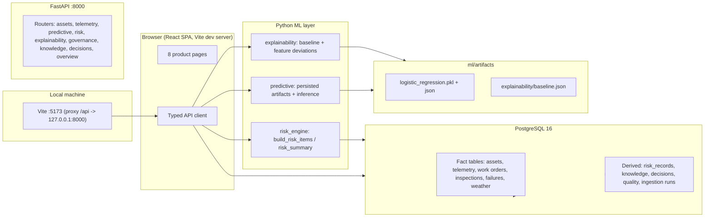

# GridOps Intelligence — Architecture

## 1. High-level system diagram

## 2. Frontend architecture

- React 18 + TypeScript (strict) + Vite + Tailwind + Recharts + React Router.
- Design system: `frontend/src/components/ui.tsx` (Card, Badge, Button, Field, Table helpers, MeterBar, Drawer, EmptyBlock, ErrorBlock, LoadingBlock, Spinner, StatCard, StatusBadge, Callout, KeyValue, SearchField), `Icons.tsx` (SVG icon set), `Shell.tsx` (dark navy sidebar + content frame), `index.css` (tokens), `tailwind.config.js`.
- Typed API client: `frontend/src/lib/api.ts`, `types.ts`, `useApi.ts` (loading / error / refresh states), `format.ts` (number, percent, probability, score, date formatting).
- Pages: Overview, Assets, Predictive, Risk, Explainability, Evidence, Decisions, Governance — each with loading / empty / error states and no raw JSON as primary UI.

## 3. Backend architecture

- FastAPI routers under `backend/app/api.py` with `backend/app/*` services:
  - `overview.py` — command center aggregates.
  - `risk_engine.py` — persisted risk records, deterministic percentile ranking, priority rules, summary.
  - `explainability.py` — baseline artifact + robust z-score deviations.
  - `predictive.py` — persisted model artifacts, evaluation payloads, inference.
  - `knowledge_routing.py`, `rag/*` — structured routing vs document retrieval, retrieval, generation, citations.
  - `governance.py` — lineage, quality, models, risk generation, audit aggregation.
  - `decision_api.py`, `decisions/*` — decision lifecycle, rationale requirement, audit events, evidence.
- SQLAlchemy models + Alembic migrations under `alembic/versions` (head: `5e6f7a8b9c0d`).
- Data engineering CLI under `data_engineering/cli.py` (generate / ingest / risk / knowledge / decisions / initialize-demo).

## 4. Data and pipeline architecture

Source ingestion → validation/quality results → feature snapshots → training/evaluation → persisted artifacts → inference → persisted risk records → explainability baseline → decisions/audit → governance views.

Key invariants:

- Source fact tables are never modified by risk generation; risk records are derived artifacts.
- Feature snapshots are leakage-safe (historical cutoff; no future/post-failure leakage).
- Model artifacts persist under `ml/artifacts/` and are bind-mounted into the API container.
- Knowledge metadata/chunks are repaired via source-header metadata parsing + forced ingestion; documents are not deleted.

## 5. Risk methodology

- Probabilities persisted from logistic regression at prediction cutoff; saturated probabilities handled with deterministic tie-breaking.
- Robust z-score deviation: |value − median| / robust scale (MAD → IQR → std fallback, floor, cap 50).
- Priority rules P1–P5 as documented on the Risk page.
- Anomaly score is not a calibrated failure probability; probability is not a calibrated field failure probability.

## 6. Evidence/RAG architecture

- Structured questions (counts, statuses) → PostgreSQL aggregations.
- Document questions → hybrid retrieval (deterministic embeddings) → citations.
- No LLM generation used in the current local demo; answers are grounded over retrieved synthetic text.

## 7. Decision and governance architecture

- Decision state machine with mandatory rationale and append-only audit events.
- No auto-approve; no auto-execution.

## 8. Runtime / deployment topology

- Frontend: Vite dev server on `127.0.0.1:5173`, proxy `/api` → `127.0.0.1:8000`.
- Backend: FastAPI in Docker (`gridops-api`), PostgreSQL in Docker (`gridops-postgres`, host port 55432 → container 5432).
- Artifacts: bind-mounted `./ml/artifacts` into API container; survive restarts.
- Startup/shutdown: `scripts/start-gridops.{ps1,cmd}`, `scripts/stop-gridops.{ps1,cmd}`; detached Vite launcher `scripts/start-frontend.py`.

## 9. Local startup sequence

1. `.\scripts\start-gridops.ps1` (Docker db → migrations → API → Vite, with health waits).
2. Frontend `http://localhost:5173`, API `http://localhost:8000`, docs `http://localhost:8000/docs`.

## 10. Test topology

- Backend: `pytest` (integration suite via FastAPI TestClient; host venv; full run ~181 passed).
- Frontend: Vitest + Testing Library (11 tests across App, Risk, Decisions, format), `tsc -b` typecheck, `vite build` production build.

## 11. Known technical debt / fixes applied in the final hardening pass

- Governance API now serializes JSONB `details` into readable strings and returns unique `result_id` keys for failing checks (fixes React crash + duplicate key warnings).
- Vite proxy target pinned to `127.0.0.1:8000` (fixes ~2s per-request latency caused by IPv6 `localhost` resolution).
- Startup scripts hardened (execution-policy-friendly, detached Vite via `start-frontend.py`, migration/healthy checks).
- Frontend copy cleanup to remove non-actionable hardcoded counts.

---

See `docs/USER_GUIDE.md`, `docs/INTERVIEW_PREPARATION.md`, and `docs/FINAL_REPORT.md` for the operating and delivery picture.
